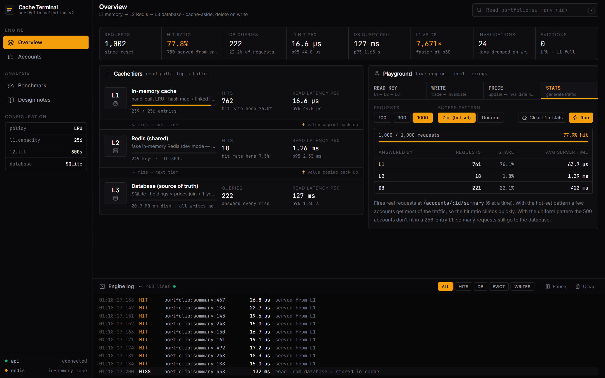
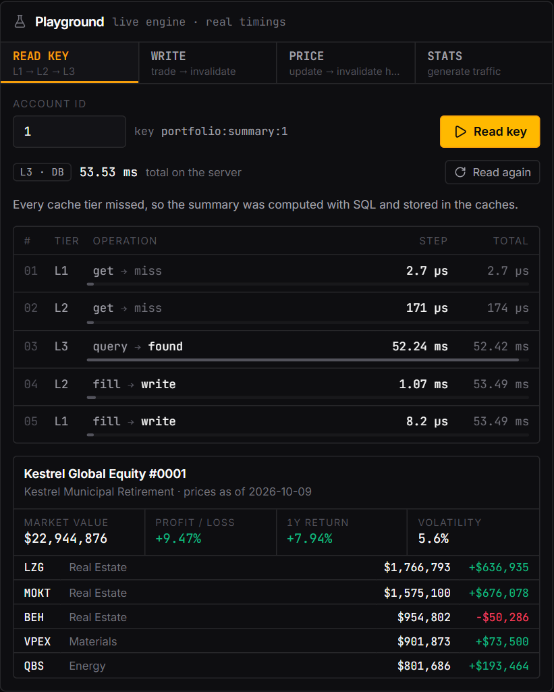
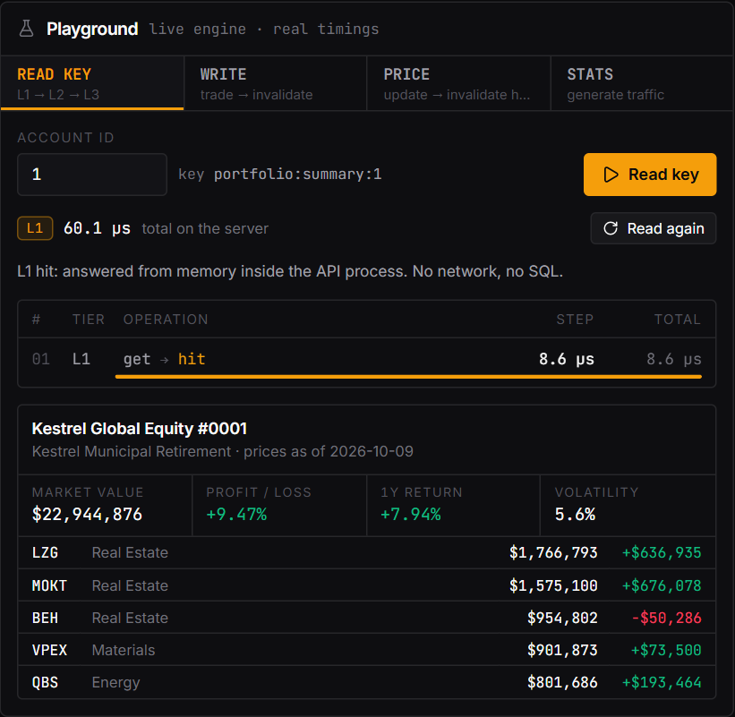
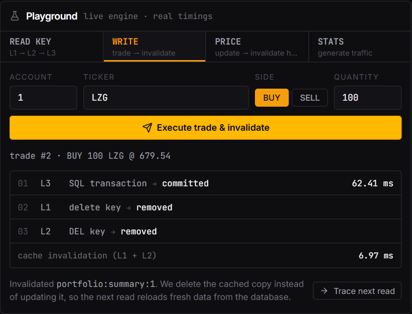
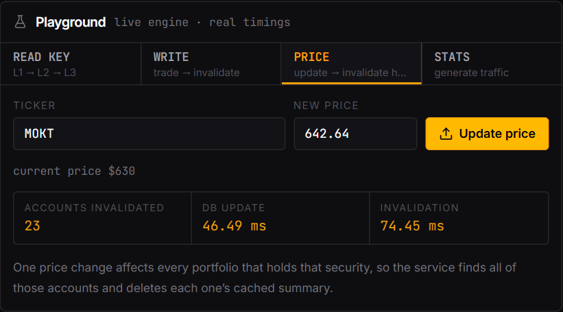
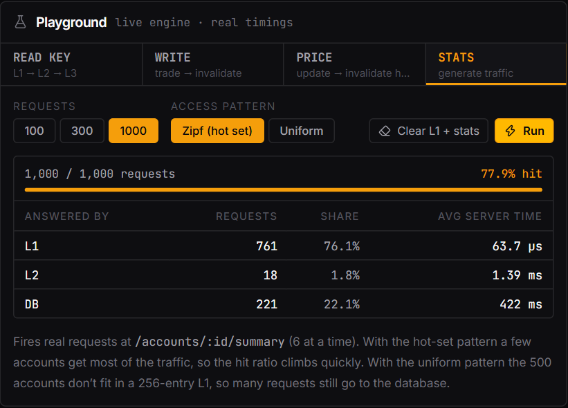
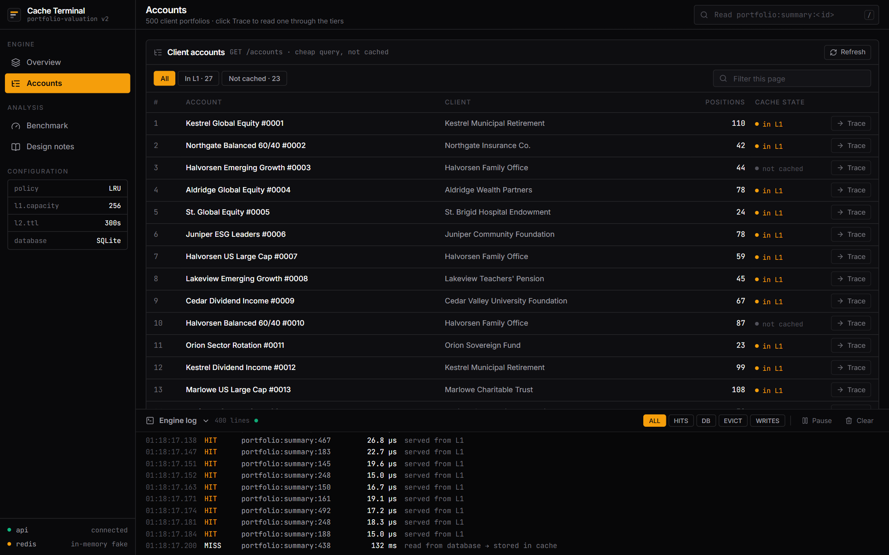
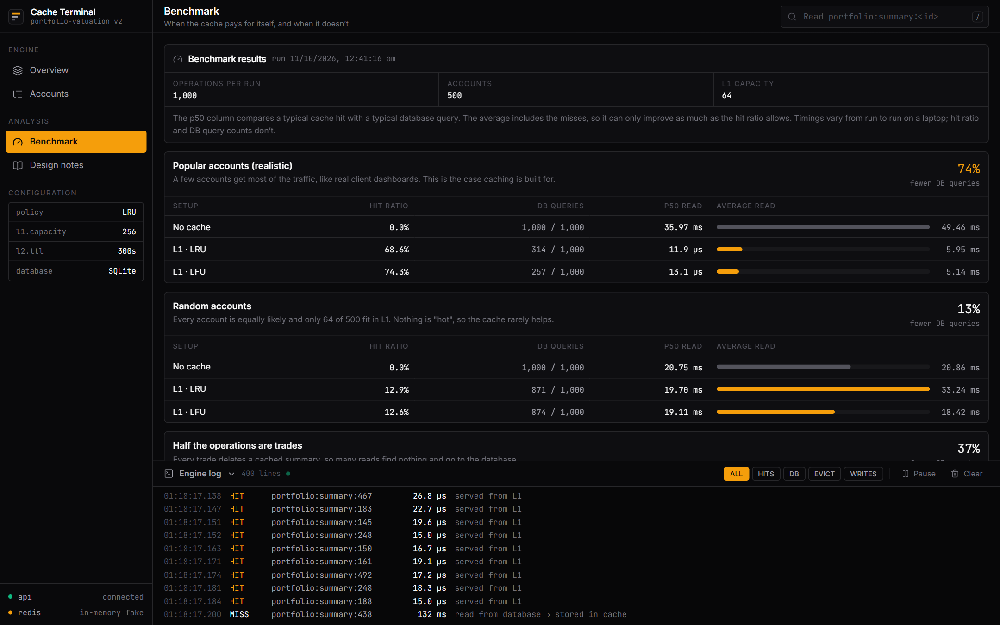

<div align="center">

# Multi-Tier Cache Engine

**A three-tier cache (in-memory LRU/LFU → Redis → SQL) behind a portfolio-valuation API,<br>with a live dashboard that traces every hit, miss and invalidation.**

[](https://github.com/ashoktanakanti/multi-tier-cache-engine/actions/workflows/tests.yml)


[**Live demo**](https://multi-tier-cache-engine.onrender.com) · [API docs](https://multi-tier-cache-engine.onrender.com/docs) · [How it works](#the-idea-in-one-minute) · [Benchmark](#does-the-cache-actually-help-benchmark) · [Run locally](#run-it-on-your-computer)

</div>

| ~70% | 3 | 51 |
|:---:|:---:|:---:|
| fewer database queries with realistic traffic | classic caching bugs handled: stale reads, race conditions, stampedes | automated tests, run on every push |

> The live demo is hosted on Render's free plan. If nobody has used it recently, the first load can take 30–60 seconds while the server wakes up.

A portfolio website for a bank's clients that answers quickly because it **remembers answers it has already worked out**. This is called *caching*. The dashboard lets you watch every request travel through the cache live.



---

## The idea in one minute

A bank has 500 clients. Each client has a portfolio of stocks. When a client opens their dashboard, the server must work out a **summary**: total value, profit/loss, top holdings, and 1-year return. Doing that means reading thousands of database rows, which takes **about 35 ms** (around 200 ms on the free Render server).

Clients refresh their dashboards all the time, so recomputing the same summary every time is wasted work. Instead, the summary is saved in three places, from fastest to slowest:

| Level | What it is | Speed | Think of it as |
|---|---|---|---|
| **L1** | Memory inside the server: an LRU / LFU cache written from scratch | ~0.01 ms | Notes on your desk |
| **L2** | Redis, a cache shared by all servers | < 1 ms | A shared whiteboard |
| **L3** | The SQL database, which always has the correct data | ~35 ms | The filing cabinet in the basement |

```
 Read a summary:   check L1 → not there? check L2 → not there? compute it from L3
                   then save a copy in L2 and L1, so next time it's instant.

 Change data:      update the database first, then DELETE the saved copies,
                   so nobody ever sees an old (stale) number.
```

**Result:** with realistic traffic, about **70% of requests never touch the database**. Those requests skip the 35 ms query and are answered from memory instead.

---

## What you can do on the website

The **Playground** panel on the Overview page has four tabs. Every number you see is measured live from the real server; nothing is simulated.

### 1. READ KEY: read a portfolio through the cache

Enter an account number (1–500) and click **Read key**.

**First read: a miss.** Neither cache has it, so it is computed from the database (L3) and saved in L2 and L1. The table shows each step and how long it took. Almost all of the time is the database query.



**Click "Read again": a hit.** Now L1 answers in microseconds. One step, no database.



### 2. WRITE: make a trade

Buy or sell shares for an account. The trade is saved in the database inside a **transaction** (all or nothing), then the cached summary for **that account only** is deleted from L1 and L2. Click **Trace next read** to see the next read go to the database again, so the new numbers appear immediately.

Selling more shares than the account owns is rejected, and nothing changes.



### 3. PRICE: change a stock's price

Pick a stock and set a new price. Every client who owns that stock now has a different portfolio value, so the cached summary of **every one of those accounts** is deleted. Accounts that don't own it stay cached.



### 4. STATS: send lots of traffic

Fire 100–1,000 real requests and watch the hit ratio climb.
- **Zipf (hot set):** a few accounts get most of the traffic, like real life. The hit ratio climbs to about 70–80%.
- **Uniform:** every account is equally likely, so the cache helps much less. This shows when caching *isn't* worth it.



### Also on the site

| Page | What it shows |
|---|---|
| **Overview** | Live totals (requests, hit ratio, latency), the three cache tiers, and the **Engine log**: every HIT, MISS, EVICT (cache full, oldest/least-used item removed) and INVAL (item deleted after a write) |
| **Accounts** | All 500 accounts. An amber dot means "this one is in L1 right now". Click **Trace** to read it. |
| **Benchmark** | Measured results comparing no cache, LRU and LFU (see below) |
| **Design notes** | Why each design choice was made |
| **`/docs`** | The API's built-in interactive documentation ([open it](https://multi-tier-cache-engine.onrender.com/docs)) |



---

## Does the cache actually help? (benchmark)

`src/backend/benchmark.py` runs 1,000 operations over 500 accounts with a small 64-item L1 cache, in three situations:

| Traffic pattern | Setup | Hit ratio | Database queries | Typical read |
|---|---|---|---|---|
| **Popular accounts** (realistic) | no cache | 0% | 1000 / 1000 | 36 ms |
| | L1 LRU | 68.6% | 314 / 1000 | **0.012 ms** |
| | L1 LFU | 74.3% | 257 / 1000 | **0.013 ms** |
| **Random accounts** | no cache | 0% | 1000 / 1000 | 21 ms |
| | L1 LRU | 12.9% | 871 / 1000 | 20 ms |
| | L1 LFU | 12.6% | 874 / 1000 | 19 ms |
| **Half the operations are trades** | no cache | 0% | 507 / 507 | 23 ms |
| | L1 LRU | 37.5% | 317 / 507 | 15 ms |
| | L1 LFU | 37.5% | 317 / 507 | 15 ms |

What this shows:
- **Realistic traffic:** the cache avoids ~70% of database work. That is the number that matters; comparing a single memory lookup to a SQL query always gives a huge ratio, so it isn't a fair headline.
- **LFU beats LRU** when the same accounts stay popular, because one-off reads can't push popular accounts out.
- **Random traffic:** only 64 of 500 accounts fit, so the cache barely helps.
- **Many writes:** each trade deletes a cached summary, so there are fewer hits.

Timings vary between runs on a laptop; hit ratio and query counts don't, so those are the reliable numbers.



---

## How it's built

| Part | Technology | Where |
|---|---|---|
| L1 cache (LRU and LFU, written from scratch) | Python: hash map + doubly linked list / frequency buckets, O(1) | `src/backend/cache_engine/lru.py`, `lfu.py` |
| L2 cache | Redis (JSON values, 5-minute expiry) | `src/backend/cache_engine/redis_tier.py` |
| Cache logic (L1 → L2 → L3) | Python | `src/backend/cache_engine/tiered.py` |
| Database | SQLite, plain SQL | `src/backend/portfolio/schema.sql`, `db.py` |
| Business logic | Python | `src/backend/portfolio/service.py` |
| REST API | FastAPI | `src/backend/portfolio/api.py` |
| Dashboard | React + Tailwind CSS | `src/frontend/` |
| Tests | pytest (51 tests) + GitHub Actions | `tests/`, `.github/workflows/` |
| Deployment | Docker on Render | `Dockerfile`, `render.yaml` |

```
src/
├── backend/                  Python: everything the server runs
│   ├── cache_engine/         the cache itself (knows nothing about portfolios)
│   │   ├── lru.py            LRU cache, built from scratch
│   │   ├── lfu.py            LFU cache, built from scratch
│   │   ├── redis_tier.py     Redis (L2) wrapper
│   │   └── tiered.py         L1 → L2 → L3 lookup, invalidation, stats
│   ├── portfolio/            the banking app that uses the cache
│   │   ├── schema.sql        database tables
│   │   ├── seed.py           generates the demo data
│   │   ├── db.py             all SQL queries
│   │   ├── service.py        portfolio summary, trades, price updates
│   │   └── api.py            REST API (FastAPI)
│   ├── benchmark.py          the performance comparison above
│   └── data/                 benchmark results (the database is generated, not stored)
└── frontend/                 React dashboard (Vite + Tailwind)
    └── src/
        ├── components/       sidebar, cache tiers, playground tabs, engine log
        ├── views/            Accounts, Benchmark, Design notes pages
        └── lib/api.js        calls to the backend

tests/                        51 automated tests (pytest)
docs/screenshots/             images used in this README
Dockerfile, render.yaml       deployment on Render
```

---

## Run it on your computer

You need **Python 3.11+** and **Node.js 18+**.

```bash
# 1. Set up Python
python -m venv .venv
.venv\Scripts\activate              # Mac/Linux: source .venv/bin/activate
pip install -r requirements.txt

# 2. Run the tests from the project root (should say "51 passed")
pytest

# 3. Go to the backend folder and create the demo database (~5 seconds)
cd src/backend
python -m portfolio.seed

# 4. Start the API, using a fake in-memory Redis so you don't need to install Redis
#    Windows PowerShell:  $env:REDIS_URL="memory://"
#    Mac/Linux:           export REDIS_URL=memory://
uvicorn portfolio.api:app --port 8000

# 5. In a second terminal, start the dashboard
cd src/frontend
npm install
npm run dev                          # open http://localhost:5173
```

**Settings** (environment variables):
- `REDIS_URL`: `memory://` (fake Redis), `redis://localhost:6379/0` (real Redis), or not set (L1 only)
- `CACHE_POLICY`: `lru` (default) or `lfu`
- `L1_CAPACITY`: how many summaries L1 can hold (default 256)
- `L1_TTL`: seconds before an L1 copy expires (default 30)

To reset the demo data, run `python -m portfolio.seed` again (inside `src/backend`) and restart the API.
To rerun the benchmark: `python benchmark.py` inside `src/backend`.

---

## Deploy your own copy on Render

1. Fork this repo, sign in to [render.com](https://render.com) with GitHub.
2. **New → Blueprint** → choose the repo → **Apply**.
3. Render builds the `Dockerfile` (frontend + API + database in one service) and gives you a URL.

On the free plan there is no real Redis, so L2 uses the in-memory fake (see *Known limitations*). Data resets whenever the server restarts.

---

## API reference

| Method | Path | What it does |
|---|---|---|
| GET | `/accounts/{id}/summary` | Portfolio summary through the cache. The `X-Cache` header says who answered: `L1`, `L2` or `DB` |
| GET | `/cache/lookup/{id}` | Same read, plus every step and its timing (used by READ KEY) |
| POST | `/accounts/{id}/trades` | Buy or sell. Body: `{"ticker": "MOKT", "side": "BUY", "quantity": 100}` |
| PUT | `/securities/{ticker}/price` | Change a price. Body: `{"close": 700}` |
| GET | `/cache/stats` | Hits per tier, hit ratio, latencies, cache sizes |
| GET | `/cache/events` | Recent cache events (the Engine log) |
| DELETE | `/cache` | Empty L1 and reset the counters |
| GET | `/accounts`, `/securities?q=`, `/benchmark`, `/health` | Supporting endpoints |

---

## Design decisions

- **Why two caches?** L1 is fastest but belongs to one server. L2 (Redis) is shared by all servers and survives restarts.
- **LRU vs LFU:** LRU keeps what was used *recently* and adapts quickly. LFU keeps what is used *most often* and resists one-off bursts. Both run in O(1).
- **Cache-aside:** the cache is only filled when someone reads, so unused accounts take no space.
- **Delete on write:** after a change, the cached copy is deleted, not edited. The next read rebuilds it from the database, so it is always correct.
- **Expiry (TTL):** Redis entries expire after 5 minutes, as a safety net.
- **Fail-open:** if Redis goes down, the app keeps working by reading from the database. Redis calls time out after 50 ms, so a hung Redis is never slower than the database it is supposed to save us from.
- **Thread safety:** the server handles several requests at once, so L1 uses a lock.
- **Transactions:** a trade updates the holding and records the trade together, or not at all.

**When caching is NOT worth it:** live tick-by-tick prices, random access over far more data than fits in the cache, data that changes on almost every read, or queries that are already fast.

### Three caching problems, and how this project handles them

These are the bugs most caches get wrong. Each has a test in `tests/test_tiered.py` that reproduces the problem; the test fails if the fix is removed.

| Problem | What goes wrong | Fix |
|---|---|---|
| **Stale copies on other servers** | A write clears the cache on the server that handled it, but another server still has the old summary in its L1. | L1 copies **expire after 30 seconds**, so no server can show an old value for longer than that. |
| **Read/write race** | A read starts querying, a trade commits and clears the cache, then the slow read finishes and saves its *old* result, so the cache is stale again. | Each key has a **version number** that every write increases. A read remembers the version it started with; if it changed, the read undoes its save. |
| **Cache stampede** | 20 requests miss the same key at the same moment, so the same 35 ms query runs 20 times. | **Single-flight:** the first request runs the query; the others wait for it and reuse the result. 20 misses → 1 query. |

### Known limitations

- **The live demo's L2 isn't really shared.** Render's free plan runs one server, and the fake Redis lives inside that same server, so in the demo L2 is just a slower copy of L1. L2 earns its place when several servers run against one real Redis; set `REDIS_URL` to a real Redis to try that.
- **Cross-server staleness is limited, not removed.** Other servers can show old data for up to 30 seconds. Broadcasting invalidations over Redis pub/sub would make it immediate.
- **LFU counts never decay.** An account that was very popular last week can keep its place in an LFU cache. Gradually ageing the counts would fix this.
